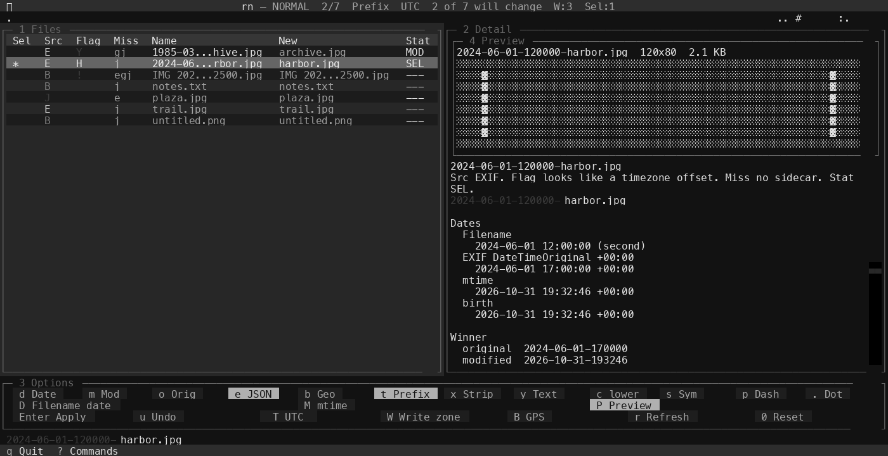

# rn


A fast, keyboard-driven terminal UI for batch renaming photos and files by EXIF date, timezone, and geodata, with live preview and undo.



Run it inside the folder you want to rename, or pass a path. `rn` works on macOS, Linux, and Windows.

## Install

`rn` needs Python 3.12 or newer. Pictures use [textual-image](https://pypi.org/project/textual-image/), which is installed with the app. HEIC and HEIF need the optional `heif` extra.

Check the version you already have:

```bash
python3 --version
```

On Windows, if `python3` is missing, use the launcher:

```powershell
py -3.12 --version
```

### PyPI and Homebrew

```bash
pipx install "tui-renamer[heif]"
brew install gradipoo/tap/rn
```

`pipx install tui-renamer` leaves HEIC off. The Homebrew formula installs the `heif` extra. The command name stays `rn`.

### Download a release

Prebuilt programs are attached to [GitHub Releases](https://github.com/Gradipoo/tui-renamer/releases) when a version tag such as `v0.1.3` is pushed.

| File | System |
| --- | --- |
| `rn-linux-x86_64` | Linux, 64-bit |
| `rn-windows-x64.exe` | Windows, 64-bit |
| `rn-macos-arm64` | macOS, Apple Silicon |

The Linux file is built on GitHub's current Ubuntu runner, so it needs a similarly recent glibc. Older distributions should use pipx or uv instead.

The macOS build is not signed or notarized. The first open is blocked until you allow it:

1. In Finder, right-click `rn-macos-arm64` and choose Open, then Open again.
2. Or, in Terminal: `xattr -d com.apple.quarantine rn-macos-arm64`

Windows SmartScreen may warn on the first launch because the file is not signed. Choose More info, then Run anyway.

Intel Macs are not in the release build. Use pipx or uv on those machines.

Make the Linux and macOS files executable (`chmod +x`) if the download did not keep that bit.

### macOS

Install Python 3.12 or newer with Homebrew if `python3 --version` is older, then install pipx:

```bash
brew install python@3.12
brew install pipx
pipx ensurepath
python3 --version
pipx install "git+https://github.com/Gradipoo/tui-renamer.git"
```

Or with uv:

```bash
uv tool install "git+https://github.com/Gradipoo/tui-renamer.git"
```

### Linux

On Arch:

```bash
sudo pacman -S python python-pipx
python3 --version
pipx install "git+https://github.com/Gradipoo/tui-renamer.git"
```

Arch's `python` package is a current 3.x. Stop if `python3 --version` is older than 3.12.

On other distributions, install Python 3.12 or newer and pipx from the package manager, then run the same `pipx install` command.

uv works the same as on macOS:

```bash
uv tool install "git+https://github.com/Gradipoo/tui-renamer.git"
```

### Windows

Install Python 3.12 or newer with the `py` launcher or winget, then pipx:

```powershell
py -3.12 --version
winget install -e --id Python.Python.3.12 --accept-package-agreements --accept-source-agreements
py -3.12 -m pip install --user pipx
py -3.12 -m pipx ensurepath
py -3.12 -m pipx install "git+https://github.com/Gradipoo/tui-renamer.git"
```

Or with uv:

```powershell
uv tool install "git+https://github.com/Gradipoo/tui-renamer.git"
```

Open a new terminal after `ensurepath` so `rn` is on `PATH`.

### Upgrade

Reinstall from git with `--force`:

```bash
pipx install --force "git+https://github.com/Gradipoo/tui-renamer.git"
uv tool install --force "git+https://github.com/Gradipoo/tui-renamer.git"
```

On Windows:

```powershell
py -3.12 -m pipx install --force "git+https://github.com/Gradipoo/tui-renamer.git"
uv tool install --force "git+https://github.com/Gradipoo/tui-renamer.git"
```

### HEIC

JPEG, PNG, GIF, WebP, BMP, and TIFF preview without an extra. HEIC and HEIF need `pillow-heif`. With that extra, their capture dates are read the same way as JPEG. Without it, those files keep their file times.

```bash
pipx install --force "tui-renamer[heif] @ git+https://github.com/Gradipoo/tui-renamer.git"
uv tool install --force "tui-renamer[heif] @ git+https://github.com/Gradipoo/tui-renamer.git"
```

On Windows:

```powershell
py -3.12 -m pipx install --force "tui-renamer[heif] @ git+https://github.com/Gradipoo/tui-renamer.git"
```

Camera RAW (CR2, NEF, ARW, DNG) is not previewed.

### From source

```bash
git clone https://github.com/Gradipoo/tui-renamer.git
cd tui-renamer
python -m venv .venv
source .venv/bin/activate
pip install -e .
rn
```

On Windows, activate with `.venv\Scripts\activate`. Use Python 3.12 or newer for that venv. Add the HEIC extra with `pip install -e ".[heif]"`.

### Download a release

Prebuilt programs are attached to [GitHub Releases](https://github.com/Gradipoo/tui-renamer/releases) when a version tag such as `v0.1.3` is pushed.

| File | System |
| --- | --- |
| `rn-linux-x86_64` | Linux, 64-bit |
| `rn-windows-x64.exe` | Windows, 64-bit |
| `rn-macos-arm64` | macOS, Apple Silicon |

The Linux file is built on GitHub's current Ubuntu runner, so it needs a similarly recent glibc. Older distributions should use pipx or uv instead.

The macOS build is not signed or notarized. The first open is blocked until you allow it:

1. In Finder, right-click `rn-macos-arm64` and choose Open, then Open again.
2. Or, in Terminal: `xattr -d com.apple.quarantine rn-macos-arm64`

Windows SmartScreen may warn on the first launch because the file is not signed. Choose More info, then Run anyway.

Intel Macs are not in the release build. Use pipx or uv on those machines.

Make the Linux and macOS files executable (`chmod +x`) if the download did not keep that bit.

Pillow, piexif, and the IANA timezone data are included. `exiftool` and macOS `SetFile` are not.

## exiftool and birth time

JPEG and TIFF date and GPS tags are written with piexif. Video (`.mov`, `.mp4`, `.m4v`), HEIC, and PNG need `exiftool` on `PATH`.

| System | Package | Command |
| --- | --- | --- |
| macOS | Homebrew | `brew install exiftool` |
| Arch | pacman | `sudo pacman -S perl-image-exiftool` |
| Debian, Ubuntu | apt | `sudo apt-get install -y libimage-exiftool-perl` |
| Fedora | dnf | `sudo dnf install -y perl-Image-ExifTool` |

On Windows, install [ExifTool](https://exiftool.org/) and put `exiftool` on `PATH`.

Birth time (the creation time photos apps show) is set on macOS with `SetFile` from the Xcode command line tools (`xcode-select --install`), and on Windows with the system file-time call. Linux updates mtime and metadata only. If `SetFile` is missing, macOS still updates mtime and EXIF.

## Usage

```bash
rn
rn ~/Pictures/trip
rn -d
```

`-d` appends a log to `renamer_debug.log` in the folder you opened.

`rn` reads the terminal. If stdin is not a terminal, it exits. On Linux it also exits if the terminal device goes away, so closing the window does not leave the process running.

Hidden files and `.json` sidecars are not listed. Sidecars are read when JSON mode is on. Sidecar lookup matches Google Takeout names, including `name.jpg.json`. Notes from scan review use `name.jpg.rn-notes.json` and are never used as Takeout dates.

## Photo review

`S` opens an optional review for the highlighted photo. Regular renaming is unchanged. Review does not start on its own. A related file is never required.

You can type chips by hand, or send the chosen image to a local [Ollama](https://ollama.com) vision model that you already installed and started. `rn` does not identify people from appearance, and it does not infer sensitive attributes. Manual names are fine. Related-file candidates are listed with labels (Likely, Possible, Unlikely). Size alone is never Likely. Lack of evidence is not disproven. You choose a related file if you want one. The folder is not analyzed in bulk.

Name chips stage an ordered suffix on the main New column as soon as you turn them on. Esc keeps that staging. The suffix is appended to the ordinary rename result. It is not a replacement for insert or the date and geo options. An empty ordinary stem plus tags becomes `tag1-tag2.ext` with no leading hyphen. Metadata is a separate control on a chip, off by default, and can be on without a filename tag. Images stay unchanged until you Apply on the main screen. Apply writes the notes sidecar, the rename, and any queued metadata. Opening, reading, toggling, or Esc does not write next to the photo. Existing capture dates are skipped unless you turn on overwrite in the overlay. Session undo covers that Apply batch. It does not recover files after you quit. Locked files keep their locked name. S tags do not rename a locked row.

A year stays a year. Only a complete written calendar day can become capture metadata, using noon if you opt in. Year, month, season, inferred, and unresolved ambiguous dates never become EXIF. Partial dates can still go in the sidecar and in a name you approve. Description writes JPEG/TIFF ImageDescription. Other types keep the text in the sidecar.

Reading is optional. On a local host, a saved vision model is read when you open `S`. First use shows installed vision models instead of a typing field. `rn` does not install Ollama, pull a model, start the server, or upload images on its own. Host defaults to `http://127.0.0.1:11434`. A host that is not loopback is never auto-uploaded. The first Read must be confirmed, because the image is sent to that host.

These tags were checked against the official library. They are not a handwriting-accuracy ranking, and we have not evaluated them on real scans.

| Pick | Command | Download (not runtime RAM) | License | Source |
| --- | --- | --- | --- | --- |
| Light | `ollama pull qwen3.5:2b` | about 2.7 to 3.1 GB | Apache License 2.0 | [qwen3.5:2b](https://ollama.com/library/qwen3.5:2b) |
| Default | `ollama pull gemma3:4b` | about 3.4 GB | Gemma Terms of Use | [gemma3:4b](https://ollama.com/library/gemma3:4b) |
| Larger | `ollama pull gemma4:e4b` | about 6.6 to 9.5 GB | Gemma Terms of Use | [gemma4](https://ollama.com/library/gemma4) |

`gemma3:270m` and `gemma3:1b` are text-only on the library page. Do not use those for a photo back. Official vision docs use `/api/generate` with an `images` array and a JSON `format` schema: [Vision](https://docs.ollama.com/capabilities/vision), [Generate](https://docs.ollama.com/api/generate). Installed models are listed with [GET /api/tags](https://docs.ollama.com/api/tags) and checked for vision with [POST /api/show](https://docs.ollama.com/api-reference/show-model-details) (`capabilities` includes `vision`). Discovery runs only against loopback. GPU notes: [Hardware](https://docs.ollama.com/gpu).

```bash
# your machine, not rn
# https://ollama.com/download
ollama serve
ollama pull gemma3:4b
```

In photo review, pick an installed vision model, or type an override and press Enter. `i` shows local installed vision models (a loaded mark when Ollama reports one). `r` and the Original button always read the current photo. The first related candidate is previewed automatically. Highlighting another file only changes that comparison. `R` and the Related Read button read the highlighted file. Both sets of chips stay, with source on each chip. `x` cancels. `b` focuses related-file suggestions. `?` shows setup help. Esc keeps the staged name and returns to the file table. The live New name is shown in the overlay. The model name is stored in `scan.json` next to the view settings. Total system RAM, when readable, is a conservative hint only. It is not free RAM or GPU VRAM.

This path is not an accuracy claim. Mock tests check chips, sidecar rules, date precision, and the UI. They do not measure real handwriting recognition.

An empty folder still opens. Press `r` after you add files.

## Pictures

`P` shows or hides the preview. That choice is remembered, and so is a zoom from `1` through `4`. Preview starts on, and there is no zoom, until you change them. Ctrl+0 resets both. Only the highlighted file is drawn.

| Terminal | What you see |
| --- | --- |
| Kitty, iTerm2, WezTerm, and Sixel terminals | The picture |
| macOS Terminal, plain tmux, and terminals without those protocols | Half blocks |

If the picture cannot be drawn, the detail pane stays up and shows the file name, size, and dates. A detail pane under 24 columns or 12 rows hides the picture and says the pane is too small.

## Keys

| Key | Action |
| --- | --- |
| `1` / `2` / `3` / `4` | Zoom files, detail, options, or preview. The same key, or Esc, restores the split |
| Up/Down, `j`/`k` | Move |
| `/` | Find in the current name and the new name. Smart case: lowercase ignores case |
| Enter / Esc | Keep the match, or restore the row you started from |
| `n` / `N` | Next or previous match after a search. Otherwise the next or previous file that will change |
| `]` / `[` | Next or previous file that will change |
| Ctrl+G | Next match. Before a search is accepted, the status line says there is no search |
| `g` then `g` / `G` | First file / last file |
| PageUp / PageDown | Page |
| Space | Select or clear this file |
| `v` | Select a range with up and down |
| `a` / `A` | Select all / select none |
| `d` `m` `o` | Add today's time, modified time, original (EXIF) time |
| `e` | Read times and location from a `.json` sidecar |
| `b` | Add the JSON location to the name |
| `t` | Timestamps at the start, or the end |
| `x` / `y` | Drop the original name / keep letters and spaces |
| `c` `s` `p` `.` | Lowercase, drop symbols, spaces to dashes, dots to dashes |
| `0` | Reset name options |
| Ctrl+0 | Reset preview and zoom |
| `!` / `@` | Next or previous warning |
| `i` | Edit this name. Esc saves. Enter saves and renames |
| `l` / `L` / `U` | Lock this file / lock selected / unlock all |
| Enter | Apply the current mode. Asks first |
| `D` | Filename date mode. Enter sets dates and EXIF |
| `M` | Set mtime mode. Enter sets times |
| `W` | Write the local time and timezone offset |
| `B` | Write JSON location into EXIF GPS |
| `T` | Choose a timezone |
| `P` | Show or hide the preview |
| `S` | Photo review for the highlighted image |
| `u` | Undo the last batch (this session only) |
| `r` | Reload the folder |
| `?`, `:`, Ctrl+P, `h`, F1 | Commands. Type to filter. `?` closes it, including from the filter |
| `q` | Quit |

While `g` is waiting, the status line shows `g then g: first file`.

The options strip under the file list shows the name toggles, the date, mtime, and preview modes, and the buttons for apply, undo, zone, write zone, GPS, refresh, and reset. A click sets the same value as the key.

The detail pane shows every date candidate for the highlighted file, which one wins, the zone, geodata, and a character diff of the old and new name. The line under the file name spells out the overview marks. Insertions are green. Deletions are red.

Esc closes find first, then leaves a zoomed pane, then leaves visual, filename date, or mtime mode.

`!` on a row means the timestamp you chose is not the oldest of modified and original. The `!` key jumps to the next warning, and `@` jumps to the previous one.

MOV, MP4, and M4V use the QuickTime creation date when the file stores one. That source is Q. A video with no capture date is not marked as missing EXIF. `exiftool` is only a fallback for reading those files, and it is still required to write video, HEIC, and PNG metadata.

Locked names stay put when you change toggles. A manual edit is used until you lock that file. Refresh clears selection, locks, and manual edits.

Filename dates understand `2024-01-31-142500`, `IMG_20240131_142500`, `2024-01-31 14.25.00`, `2024-01-31_1425`, and `20240131`. A date with no time becomes 12:00, unless the file's calendar day already matches, in which case the clock is left alone. If two files land on the same second, the later one is nudged by one second.

Undo remembers renames and metadata writes until you quit. JPEG and TIFF EXIF is restored from the previous segment. Files written with `exiftool` are copied to a temp folder first. If that copy fails, the write still happens and the status line says that file cannot be undone.

## License

Copyright (C) 2026 Gradipoo.

GNU General Public License v3.0. You can use, change, and share this program. If you distribute a modified version, or a program that includes this code, that program must also be under GPLv3 and you must offer the source. See [LICENSE](LICENSE).
