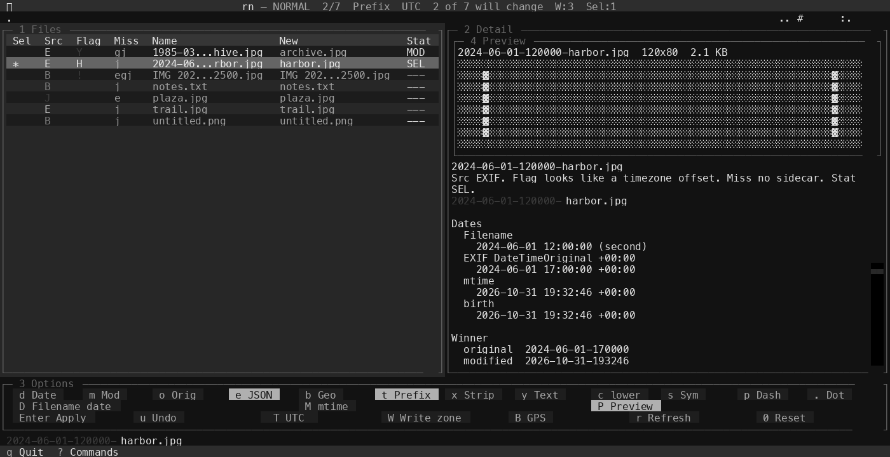

# rn


A fast, keyboard-driven terminal UI for batch renaming photos and files by EXIF date, timezone, and geodata, with live preview and undo.



Run it inside the folder you want to rename, or pass a path. `rn` works on macOS, Linux, and Windows.

## Install

`rn` needs Python 3.12 or newer. Pictures use [textual-image](https://pypi.org/project/textual-image/), which is installed with the app. HEIC and HEIF need the optional `heif` extra.

Check the version you already have:

```bash
python3 --version
```

On Windows, if `python3` is missing, use the launcher:

```powershell
py -3.12 --version
```

### Download a release

Prebuilt programs are attached to [GitHub Releases](https://github.com/Gradipoo/tui-renamer/releases) when a version tag such as `v0.1.2` is pushed.

| File | System |
| --- | --- |
| `rn-linux-x86_64` | Linux, 64-bit |
| `rn-windows-x64.exe` | Windows, 64-bit |
| `rn-macos-arm64` | macOS, Apple Silicon |

The Linux file is built on GitHub's current Ubuntu runner, so it needs a similarly recent glibc. Older distributions should use pipx or uv instead.

The macOS build is not signed or notarized. The first open is blocked until you allow it:

1. In Finder, right-click `rn-macos-arm64` and choose Open, then Open again.
2. Or, in Terminal: `xattr -d com.apple.quarantine rn-macos-arm64`

Windows SmartScreen may warn on the first launch because the file is not signed. Choose More info, then Run anyway.

Intel Macs are not in the release build. Use pipx or uv on those machines.

Make the Linux and macOS files executable (`chmod +x`) if the download did not keep that bit.

### macOS

Install Python 3.12 or newer with Homebrew if `python3 --version` is older, then install pipx:

```bash
brew install python@3.12
brew install pipx
pipx ensurepath
python3 --version
pipx install "git+https://github.com/Gradipoo/tui-renamer.git"
```

Or with uv:

```bash
uv tool install "git+https://github.com/Gradipoo/tui-renamer.git"
```

### Linux

On Arch:

```bash
sudo pacman -S python python-pipx
python3 --version
pipx install "git+https://github.com/Gradipoo/tui-renamer.git"
```

Arch's `python` package is a current 3.x. Stop if `python3 --version` is older than 3.12.

On other distributions, install Python 3.12 or newer and pipx from the package manager, then run the same `pipx install` command.

uv works the same as on macOS:

```bash
uv tool install "git+https://github.com/Gradipoo/tui-renamer.git"
```

### Windows

Install Python 3.12 or newer with the `py` launcher or winget, then pipx:

```powershell
py -3.12 --version
winget install -e --id Python.Python.3.12 --accept-package-agreements --accept-source-agreements
py -3.12 -m pip install --user pipx
py -3.12 -m pipx ensurepath
py -3.12 -m pipx install "git+https://github.com/Gradipoo/tui-renamer.git"
```

Or with uv:

```powershell
uv tool install "git+https://github.com/Gradipoo/tui-renamer.git"
```

Open a new terminal after `ensurepath` so `rn` is on `PATH`.

### Upgrade

Reinstall from git with `--force`:

```bash
pipx install --force "git+https://github.com/Gradipoo/tui-renamer.git"
uv tool install --force "git+https://github.com/Gradipoo/tui-renamer.git"
```

On Windows:

```powershell
py -3.12 -m pipx install --force "git+https://github.com/Gradipoo/tui-renamer.git"
uv tool install --force "git+https://github.com/Gradipoo/tui-renamer.git"
```

### HEIC

JPEG, PNG, GIF, WebP, BMP, and TIFF preview without an extra. HEIC and HEIF need `pillow-heif`:

```bash
pipx install --force "tui-renamer[heif] @ git+https://github.com/Gradipoo/tui-renamer.git"
uv tool install --force "tui-renamer[heif] @ git+https://github.com/Gradipoo/tui-renamer.git"
```

On Windows:

```powershell
py -3.12 -m pipx install --force "tui-renamer[heif] @ git+https://github.com/Gradipoo/tui-renamer.git"
```

Camera RAW (CR2, NEF, ARW, DNG) is not previewed.

### From source

```bash
git clone https://github.com/Gradipoo/tui-renamer.git
cd tui-renamer
python -m venv .venv
source .venv/bin/activate
pip install -e .
rn
```

On Windows, activate with `.venv\Scripts\activate`. Use Python 3.12 or newer for that venv. Add the HEIC extra with `pip install -e ".[heif]"`.

### Download a release

Prebuilt programs are attached to [GitHub Releases](https://github.com/Gradipoo/tui-renamer/releases) when a version tag such as `v0.1.2` is pushed.

| File | System |
| --- | --- |
| `rn-linux-x86_64` | Linux, 64-bit |
| `rn-windows-x64.exe` | Windows, 64-bit |
| `rn-macos-arm64` | macOS, Apple Silicon |

The Linux file is built on GitHub's current Ubuntu runner, so it needs a similarly recent glibc. Older distributions should use pipx or uv instead.

The macOS build is not signed or notarized. The first open is blocked until you allow it:

1. In Finder, right-click `rn-macos-arm64` and choose Open, then Open again.
2. Or, in Terminal: `xattr -d com.apple.quarantine rn-macos-arm64`

Windows SmartScreen may warn on the first launch because the file is not signed. Choose More info, then Run anyway.

Intel Macs are not in the release build. Use pipx or uv on those machines.

Make the Linux and macOS files executable (`chmod +x`) if the download did not keep that bit.

Pillow, piexif, and the IANA timezone data are included. `exiftool` and macOS `SetFile` are not.

## exiftool and birth time

JPEG and TIFF date and GPS tags are written with piexif. Video (`.mov`, `.mp4`, `.m4v`), HEIC, and PNG need `exiftool` on `PATH`.

| System | Package | Command |
| --- | --- | --- |
| macOS | Homebrew | `brew install exiftool` |
| Arch | pacman | `sudo pacman -S perl-image-exiftool` |
| Debian, Ubuntu | apt | `sudo apt-get install -y libimage-exiftool-perl` |
| Fedora | dnf | `sudo dnf install -y perl-Image-ExifTool` |

On Windows, install [ExifTool](https://exiftool.org/) and put `exiftool` on `PATH`.

Birth time (the creation time photos apps show) is set on macOS with `SetFile` from the Xcode command line tools (`xcode-select --install`), and on Windows with the system file-time call. Linux updates mtime and metadata only. If `SetFile` is missing, macOS still updates mtime and EXIF.

## Usage

```bash
rn
rn ~/Pictures/trip
rn -d
```

`-d` appends a log to `renamer_debug.log` in the folder you opened.

`rn` reads the terminal. If stdin is not a terminal, it exits. On Linux it also exits if the terminal device goes away, so closing the window does not leave the process running.

Hidden files and `.json` sidecars are not listed. Sidecars are read when JSON mode is on. Sidecar lookup matches Google Takeout names, including `name.jpg.json`.

An empty folder still opens. Press `r` after you add files.

## Pictures

`P` shows or hides the preview for this session. It starts on. Only the highlighted file is drawn.

| Terminal | What you see |
| --- | --- |
| Kitty, iTerm2, WezTerm, and Sixel terminals | The picture |
| macOS Terminal, plain tmux, and terminals without those protocols | Half blocks |

If the picture cannot be drawn, the detail pane stays up and shows the file name, size, and dates. A detail pane under 24 columns or 12 rows hides the picture and says the pane is too small.

## Keys

| Key | Action |
| --- | --- |
| `1` / `2` / `3` / `4` | Zoom files, detail, options, or preview. The same key, or Esc, restores the split |
| Up/Down, `j`/`k` | Move |
| `/` | Find in the current name and the new name. Smart case: lowercase ignores case |
| Enter / Esc | Keep the match, or restore the row you started from |
| `n` / `N` | Next or previous match after a search. Otherwise the next or previous file that will change |
| `]` / `[` | Next or previous file that will change |
| Ctrl+G | Next match. Before a search is accepted, the status line says there is no search |
| `g` then `g` / `G` | First file / last file |
| PageUp / PageDown | Page |
| Space | Select or clear this file |
| `v` | Select a range with up and down |
| `a` / `A` | Select all / select none |
| `d` `m` `o` | Add today's time, modified time, original (EXIF) time |
| `e` | Read times and location from a `.json` sidecar |
| `b` | Add the JSON location to the name |
| `t` | Timestamps at the start, or the end |
| `x` / `y` | Drop the original name / keep letters and spaces |
| `c` `s` `p` `.` | Lowercase, drop symbols, spaces to dashes, dots to dashes |
| `0` | Reset name options |
| `i` | Edit this name. Esc saves. Enter saves and renames |
| `l` / `L` / `U` | Lock this file / lock selected / unlock all |
| Enter | Apply the current mode. Asks first |
| `D` | Filename date mode. Enter sets dates and EXIF |
| `M` | Set mtime mode. Enter sets times |
| `W` | Write the local time and timezone offset |
| `B` | Write JSON location into EXIF GPS |
| `T` | Choose a timezone |
| `P` | Show or hide the preview |
| `u` | Undo the last batch (this session only) |
| `r` | Reload the folder |
| `?`, `:`, Ctrl+P, `h`, F1 | Commands. Type to filter. `?` closes it, including from the filter |
| `q` | Quit |

While `g` is waiting, the status line shows `g then g: first file`.

The options strip under the file list shows the name toggles, the date, mtime, and preview modes, and the buttons for apply, undo, zone, write zone, GPS, refresh, and reset. A click sets the same value as the key.

The detail pane shows every date candidate for the highlighted file, which one wins, the zone, geodata, and a character diff of the old and new name. The line under the file name spells out the overview marks. Insertions are green. Deletions are red.

Esc closes find first, then leaves a zoomed pane, then leaves visual, filename date, or mtime mode.

`!` means the timestamp you chose is not the oldest of modified and original.

Locked names stay put when you change toggles. A manual edit is used until you lock that file. Refresh clears selection, locks, and manual edits.

Filename dates understand `2024-01-31-142500`, `IMG_20240131_142500`, `2024-01-31 14.25.00`, `2024-01-31_1425`, and `20240131`. A date with no time becomes 12:00, unless the file's calendar day already matches, in which case the clock is left alone. If two files land on the same second, the later one is nudged by one second.

Undo remembers renames and metadata writes until you quit. JPEG and TIFF EXIF is restored from the previous segment. Files written with `exiftool` are copied to a temp folder first. If that copy fails, the write still happens and the status line says that file cannot be undone.

## License

Copyright (C) 2026 Gradipoo.

GNU General Public License v3.0. You can use, change, and share this program. If you distribute a modified version, or a program that includes this code, that program must also be under GPLv3 and you must offer the source. See [LICENSE](LICENSE).
